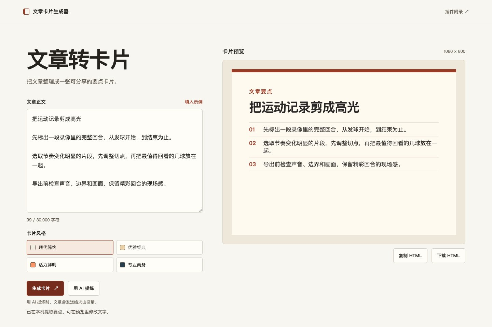

# Article Card Maker

English · [简体中文](README.zh-CN.md)

Turn long articles into editable, shareable visual cards.

## What you can do

Paste an article and choose one of four styles. Edit the preview, then copy or download standalone HTML.

## Getting started

Run these commands locally or use them to restore the existing Mac setup.

~~~sh
node web-server.cjs
~~~

Local address [http://127.0.0.1:3230/](http://127.0.0.1:3230/)

## Project layout

| Path | Purpose |
| --- | --- |
| `index.html` | Editor and preview |
| `app.js` | Form and export |
| `card.js` | Extraction and card generation |
| `web-server.cjs` | Optional local AI backend |
| `appendix.html` | Legacy plugin notes |

## Requirements and data

Open index.html for browser-only extraction. Optional AI mode requires your own provider configuration and credentials.

The source is public for inspection. No general open-source license has been applied.
