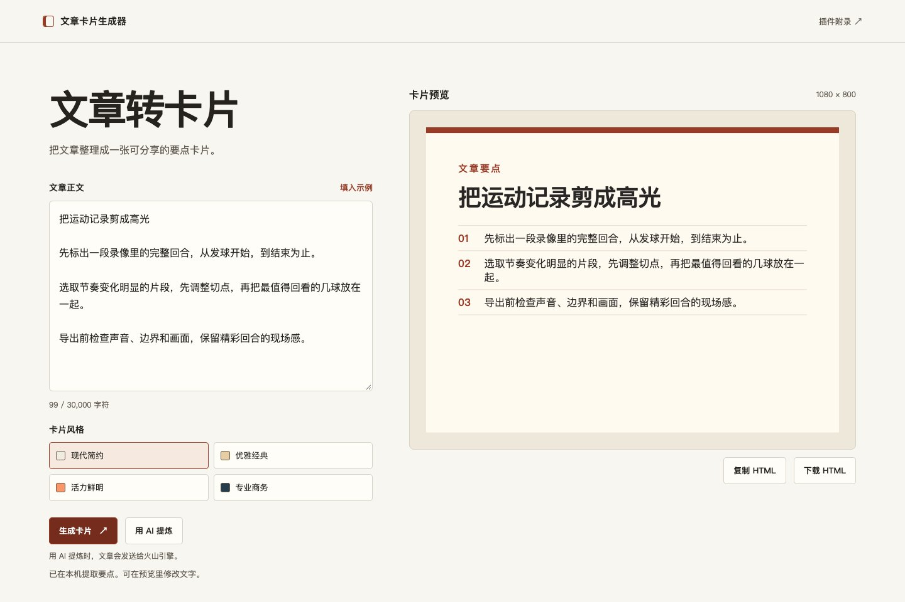

# 文章卡片生成器

简体中文 · [English](README.md)

把长文章整理成可编辑、可分享的图文卡片。

## 使用功能

粘贴文章，选择四种排版样式之一；直接修改预览文字；复制或下载独立 HTML。

## 启动方式

以下命令用于本机运行或在现有 Mac 环境恢复。

~~~sh
node web-server.cjs
~~~

本机入口 [http://127.0.0.1:3230/](http://127.0.0.1:3230/)

## 目录结构

| 路径 | 用途 |
| --- | --- |
| `index.html` | 文章编辑与预览 |
| `app.js` | 表单和导出 |
| `card.js` | 文本提取与卡片生成 |
| `web-server.cjs` | 可选本机 AI 服务 |
| `appendix.html` | 历史插件说明 |

## 运行条件与数据

直接打开 index.html 也可使用浏览器提取。可选 AI 模式需要自己配置服务和凭据。

公开代码供查阅，仓库尚未附通用开源许可证。
